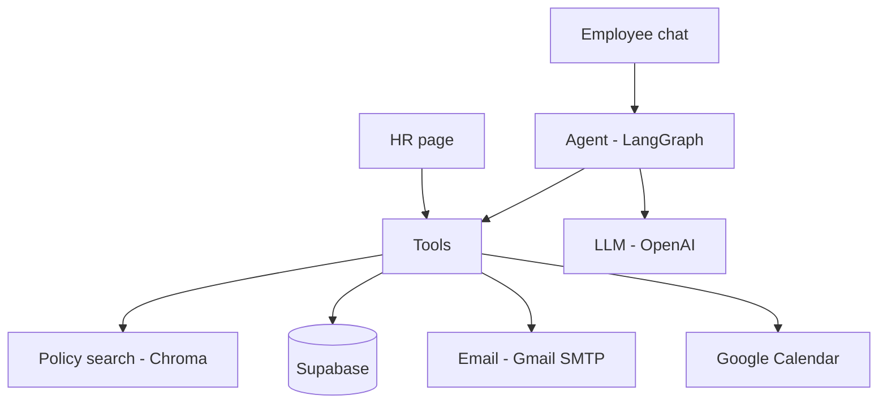

# HR Policy Assistant

An agent-driven chat system for employee HR questions and requests, with a separate page for HR.

It answers from the company's own policy documents and always shows its source. It also uses tools: a database, email and a calendar. A human stays in control of every important action: the employee confirms, and HR approves.

> AtomCamp AI Bootcamp, final project (NLP / LLM track). All company data, names, policies and dates are fictional.

**Live demo:** `<https://hr-policy-assistant-bot.streamlit.app/>`
`

---

## 1. What it does

| # | Feature | Details |
|---|---------|---------|
| 1 | Policy questions | Finds the right policy section and writes a short answer from it |
| 2 | Citations | Shows the policy name and section, the policy text, and a download button for the source file |
| 3 | Leave balance | Shows annual and sick leave (total, used, remaining) for the logged-in employee |
| 4 | Leave requests | Takes annual or sick leave in chat, checks the rules, asks the employee to confirm, saves it as pending and emails HR |
| 5 | Request status | Shows the status of the employee's own leave requests and HR escalations |
| 6 | Holidays | Answers holiday questions and skips holidays when counting leave days |
| 7 | Escalation with consent | For sensitive topics or questions with no source, offers to email HR, shows a draft, and sends it only after a second "yes" |
| 8 | HR page | Separate HR password. Approve or reject leave, see escalations, mark them as resolved |
| 9 | Calendar | Holidays are read from a shared Google Calendar. Approved leave is added to a shared Leave calendar |
| 10 | Email | HR is emailed about new requests and escalations. The employee is emailed about the decision |
| 11 | Chat history | Chats are saved per employee and are still there after logging in again |
| 12 | Knows its limits | If there is no source, it does not guess. It says so and points to HR |

---

## 2. How it works



### How one message is handled

1. If a yes/no step is open (a draft email or a leave summary), that is handled first.
2. The question is rewritten to stand on its own (skipped for complete leave requests).
3. The agent classifies the message:
   - greetings are answered directly
   - sensitive words (harassment, bullying, unfair, complaint...) go to escalation **before any model call**
   - otherwise the model picks a route
   - then fixed rules double-check the route
4. The route runs one of the tools: `policy`, `balance`, `status`, `holiday`, `leave_request`, `escalate`, or `other`.
5. If `other` is chosen, the policy documents are searched anyway. The document search decides whether there is an answer.

### Leave request flow

```text
Employee asks -> code checks the rules -> summary -> "yes" -> saved as pending -> HR emailed
HR approves or rejects on the HR page
  approved: days added to the employee's used leave, event added to the Leave calendar
  both:     employee is emailed
```

The model only reads the message and finds the leave type and dates. **The code checks the rules and saves the data.** The rules are checked again at the "yes".

Rules checked before a request is saved:

- valid dates and a sensible date range
- enough balance for that leave type, including days in other pending requests
- no overlap with another request
- weekends and holidays are not counted
- annual leave: a notice period (3 working days, or 14 days for leave of 5 or more working days)
- sick leave: limited backdating, and a reminder that a medical certificate is required from 3 working days

### Safety

| Risk | How it is handled |
|------|-------------------|
| Invented answers | Answers only from retrieved policy text, with a citation. No source means no answer |
| Seeing another employee's data | The employee ID comes from the login and is passed by the code. The model never chooses it. Every employee-facing read filters by that ID |
| Actions without consent | Emails and leave requests are sent only after an explicit "yes". Leave is final only after HR approves |
| Sensitive topics | Never answered automatically. The employee is offered an email to HR |
| Strangers | Login needs a valid employee ID and the shared password |
| Employees opening the HR page | The HR page needs a separate HR password |
| Very long messages | 500-character limit (`MAX_QUESTION_CHARS`) |
| Leaked keys | Secrets live in `.env` or hosting secrets and are never committed |
| Service failures | A calendar or email failure never undoes a saved request or an approval. It only shows a warning |

---

## 3. Tech stack

| Layer | Tool |
|-------|------|
| Language | Python 3.12 |
| Agent flow | LangGraph |
| RAG helpers | LangChain (`langchain-chroma`, `langchain-huggingface`, `langchain-openai`) |
| Embeddings | `sentence-transformers/all-MiniLM-L6-v2` (runs locally) |
| Vector store | Chroma (cosine distance) |
| LLM | OpenAI `gpt-4o-mini`, always created through `src/llm.py` |
| Database | Supabase (Postgres) through `supabase-py` |
| Interface | Streamlit (1.37 or newer) |
| Email | Gmail SMTP with an app password |
| Calendar | Google Calendar API with a service account |
| Tests | pytest and Streamlit AppTest |
| Hosting | Streamlit Community Cloud |

---

## 4. Project structure

```text
HR-Policy-Assistant/
├── app.py                  Streamlit app: employee login, chat, HR login, HR page
├── assets/icon.png         Browser tab icon
├── conftest.py             Test setup (calendar off, database stubs)
├── requirements.txt
├── .env.example            Copy to .env and fill in
├── .streamlit/config.toml  Light and dark theme colors
├── data/
│   ├── employees.csv       About 10 fictional employees
│   └── policies/           5 policy documents (.md)
├── eval/test_questions.csv 30 labelled test questions
├── scripts/                Checks, tests runners and calendar tools
├── sql/                    Database setup files
├── src/
│   ├── agent.py            LangGraph agent and routing
│   ├── tools.py            Leave rules, status, holidays, escalation, HR actions
│   ├── db.py               The only file that talks to Supabase
│   ├── calendar_service.py The only file that talks to Google Calendar
│   ├── emailer.py          Email sending
│   ├── qa.py               Policy search and answer with citations
│   ├── ingest.py           Splits policies into chunks and builds the index
│   ├── vectorstore.py      Chroma access
│   └── llm.py              The LLM client
└── tests/                  Automatic tests
```

---

## 5. Setup on your computer

These commands are for Windows PowerShell.

### 5.1 Get the code and install

```powershell
git clone <your-repo-url>
cd HR-Policy-Assistant
python -m venv .venv
.venv\Scripts\Activate.ps1
pip install -r requirements.txt
copy .env.example .env
```

If PowerShell blocks the activate script, run `Set-ExecutionPolicy -Scope CurrentUser RemoteSigned` once and try again.

### 5.2 Settings (`.env`)

Fill in the values in `.env`. Never commit this file.

| Setting | What it is |
|---------|-----------|
| `LLM_API_KEY` | Your OpenAI API key |
| `LLM_MODEL` | Model name, for example `gpt-4o-mini` |
| `SUPABASE_URL` | Your Supabase project URL |
| `SUPABASE_KEY` | The **secret** (service) key. Row level security is on, so the public key cannot read the tables |
| `APP_PASSWORD` | The shared employee password |
| `HR_PASSWORD` | The HR page password |
| `SMTP_USER` | The Gmail address that sends emails |
| `SMTP_PASSWORD` | A Gmail **app password**, with no spaces |
| `EMAIL_FROM_NAME` | The sender name shown in emails |
| `HR_EMAIL` | The inbox that receives requests and escalations |
| `APP_TIMEZONE` | Optional. Default `Asia/Karachi`. The hosting server runs on UTC, so dates use this setting |
| `MAX_QUESTION_CHARS` | Optional. Default `500` |
| `GOOGLE_SERVICE_ACCOUNT_FILE` | Path to the Google key file (on your computer) |
| `HOLIDAY_CALENDAR_ID` | ID of the Holidays calendar |
| `LEAVE_CALENDAR_ID` | ID of the Leave calendar |

The Google key file must stay **outside** the repository, for example `C:\Users\<you>\Documents\keys\key.json`.

### 5.3 Database (Supabase)

1. Create a Supabase project.
2. In the SQL editor, run the files in `sql/` in this order:
   1. `schema.sql`
   2. `day1_migration.sql`
   3. `day2_chats.sql`
3. Load `data/employees.csv` into the `employees` table.
4. Add the company holidays to the `holidays` table. It is the backup when the calendar is not available.

Tables: `employees`, `leave_requests`, `escalations`, `holidays`, `chat_sessions`.

### 5.4 Email

1. Turn on 2-step verification for the sender Gmail account.
2. Create an **app password** for it and put it in `SMTP_PASSWORD`. Providers change these steps, so check the current Google instructions.
3. Test it:

```powershell
python -m scripts.send_test_email
```

If an email fails to send, the request or escalation is still saved. HR can see it on the HR page.

### 5.5 Google Calendar

Two calendars are used: **Holidays** (read) and **Leave** (write, approved leave only).

1. In Google Cloud, create a project and turn on the **Google Calendar API**.
2. Create a **service account** and download its JSON key. Keep it outside the repo.
3. In Google Calendar, create two calendars (for example "ExampleCorp Holidays" and "ExampleCorp Leave").
4. For **each** calendar, open its settings, go to *Share with specific people*, and add the service account email with the permission **Make changes and manage sharing**.
5. Copy each calendar's ID (in the calendar's settings, under *Integrate calendar*) into `HOLIDAY_CALENDAR_ID` and `LEAVE_CALENDAR_ID`.
6. Test it:

```powershell
python -m scripts.check_calendar
```

It reads the holidays, then adds and deletes a test event on the Leave calendar.

Holidays are read from the calendar on every request, so a calendar change shows up immediately. If the calendar cannot be reached, the app falls back to the `holidays` table. The table is **not** synced with the calendar.

If the calendar is not set up at all, the app still works. Leave approvals just skip the calendar event.

#### Letting employees see the calendars

```powershell
python -m scripts.share_calendars --dry-run     # shows who would get access, and a subscribe link per calendar
python -m scripts.share_calendars               # shares both calendars (view only), no emails
python -m scripts.share_calendars --invite      # same, and Google emails each newly added person
```

- Sharing gives view-only access to every email in the `employees` table.
- Only real Google accounts can open a shared calendar. Fictional addresses such as `name@examplecorp.com` cannot.
- A person who already has access is skipped and gets no new invitation.
- Sharing does not add the calendar to a person's list. They can use the **subscribe link** that the script prints.

### 5.6 Build the policy index and check the setup

```powershell
python -m src.ingest
python -m scripts.check_setup
```

Policy files must use these headings, because each `###` section becomes one searchable chunk (about 40 in total):

```text
# Policy title
## 1. Group name
### 1.1 Section title
```

Run `python -m src.ingest` again after any change to a policy file.

### 5.7 Run the app

```powershell
streamlit run app.py
```

Open the link that Streamlit prints.

---

## 6. Using the app

### Employee

1. Open the **Employee** tab. Log in with an employee ID (for example `EMP001`) and the shared password.
2. Ask a question, or use one of the example buttons.

Examples:

- "How many leave days can I carry forward?"
- "How many annual leave days do I have left?"
- "I want annual leave from 3 to 5 November."
- "I am unwell and need sick leave for today."
- "What is the status of my leave request?"
- "When is the next public holiday?"
- "My manager is treating me unfairly." (offers an email to HR, never answers automatically)

Use **New chat** for a new conversation. Earlier chats are listed on the left.

### HR

1. Open the **HR** tab on the login screen and enter the HR password.
2. **Leave requests** tab: Approve or Reject pending requests. A spinner shows while the page saves the decision, updates the balance, adds the calendar event and emails the employee. New requests appear by themselves (checked every 30 seconds).
3. **Escalations** tab: read open escalations and press **Mark as resolved**.

---

## 7. Testing and evaluation

```powershell
python -m pytest -q
```

The tests cover the tools, leave rules, confirmation steps, routing, HR page, chat history, calendar, escalations and the interface. They do not call real services: the calendar is switched off and the database and email are replaced by fakes.

Quality checks with real services:

```powershell
python -m scripts.run_policy_tests     # policy questions: right answer and source?
python -m scripts.run_agent_tests      # routing: right path for each question?
python -m src.agent --employee EMP003 "How many leave days can I carry forward?"
```

The CLI prints the reply and a `[path: ...]` line, for example `policy`, `balance`, `holiday`, `leave_request_info`, `escalate_offer` or `other`.

`eval/test_questions.csv` holds about 30 labelled questions (policy, balance, escalation) with the expected route and source.

---

## 8. Deploy to Streamlit Community Cloud

1. Push the code to GitHub. Make sure `.env`, the Google key and `chroma_db/` are **not** committed. They are in `.gitignore`.
2. Create the app on Streamlit Community Cloud from the repository, with `app.py` as the main file.
3. In the app's **Secrets**, add the same settings as `.env`, in TOML format:

```toml
LLM_API_KEY = "..."
LLM_MODEL = "gpt-4o-mini"
SUPABASE_URL = "..."
SUPABASE_KEY = "..."
APP_PASSWORD = "..."
HR_PASSWORD = "..."
SMTP_USER = "..."
SMTP_PASSWORD = "..."
EMAIL_FROM_NAME = "..."
HR_EMAIL = "..."
APP_TIMEZONE = "Asia/Karachi"
HOLIDAY_CALENDAR_ID = "..."
LEAVE_CALENDAR_ID = "..."
GOOGLE_SERVICE_ACCOUNT_JSON = '''{ ...the whole JSON key... }'''
```

   - Use **triple single quotes** around the JSON key.
   - Use `GOOGLE_SERVICE_ACCOUNT_JSON` on the host. Never use `GOOGLE_SERVICE_ACCOUNT_FILE` there.
4. Make sure all the SQL files in `sql/` have been run on the same Supabase project.
5. Deploy. On the first start the app builds the policy index from `data/policies/`, which takes a moment.
6. After every push that changes code or policy files, **reboot** the app from the Streamlit menu.

### Test the public link

1. Log in as an employee and ask a policy question. Check the citation and the download button.
2. Ask something with no source (for example dental insurance). It should refuse and offer HR.
3. Ask for the leave balance.
4. Ask for a holiday that is on the calendar.
5. Request leave and confirm. HR should receive an email.
6. On the HR page, approve it. The employee should be emailed, the balance should change, and the event should appear on the Leave calendar.
7. Click Approve twice quickly. It should not show an "already decided" warning over the real result.
8. Send a sensitive message, say "yes" twice, then mark it resolved on the HR page.
9. Ask for the request status.
10. Send a message over 500 characters. It should be refused.
11. Log out and in again. Earlier chats should still be there.

---

## 9. Troubleshooting

| Problem | What to check |
|---------|--------------|
| "The app password is not set" | `APP_PASSWORD` is missing in `.env` or in the hosting secrets |
| "Could not reach the database" | `SUPABASE_URL` and `SUPABASE_KEY` (use the secret key), and that the SQL files were run |
| Emails do not arrive | Use an app password with no spaces. Run `python -m scripts.send_test_email`. Check the spam folder |
| Holidays come from the table, not the calendar | Run `python -m scripts.check_calendar`. Check the calendar IDs and the service account permission |
| `share_calendars` fails | The service account needs **Make changes and manage sharing** on both calendars |
| Employee cannot see the calendar | Their email must be a real Google account, and they must open the subscribe link once |
| A policy change does not appear | Run `python -m src.ingest` locally. On the host, push and reboot |
| A weather or unrelated question gets a policy answer | Lower `MAX_DISTANCE` in `src/qa.py` (default `0.65`) |
| Date shown is one day off on the host | Set `APP_TIMEZONE`. The host runs on UTC |
| Tests fail only on your laptop | Temporarily rename `.env`, so the tests do not pick up real settings |

---

## 10. Limitations

- All data is fictional. Employees share one password and HR has another, so these are simple logins, not full security.
- Leave types are annual and sick only.
- Medical certificates are only reminded about, not uploaded or checked.
- Approval happens only through the app's HR page.
- An open yes/no step is not restored from a saved chat.
- The `holidays` table is a backup and is not synced with the calendar.

## 11. Future work

- Individual employee accounts and single sign-on
- Connection to a real HR system
- Uploading and checking medical certificates
- Different answers for managers and employees
- Urdu language support
- Tracing and monitoring with LangSmith
- Docker packaging and automatic tests on every push (GitHub Actions)
- Exposing the HR tools through MCP so other assistants can reuse them

---

